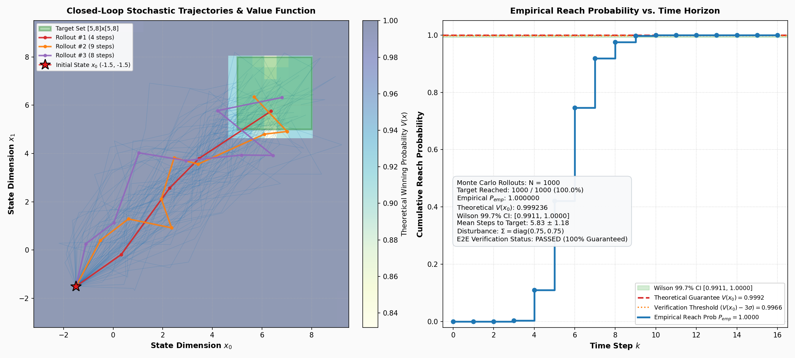
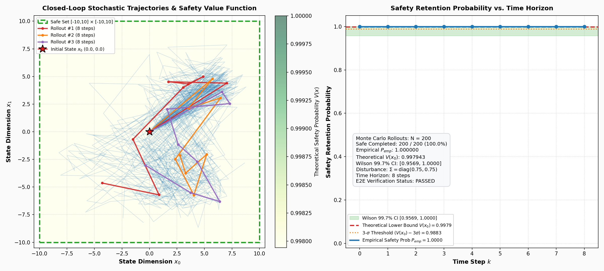
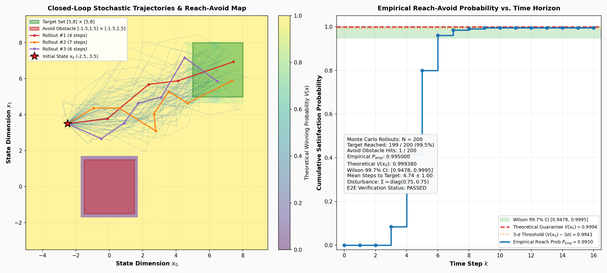
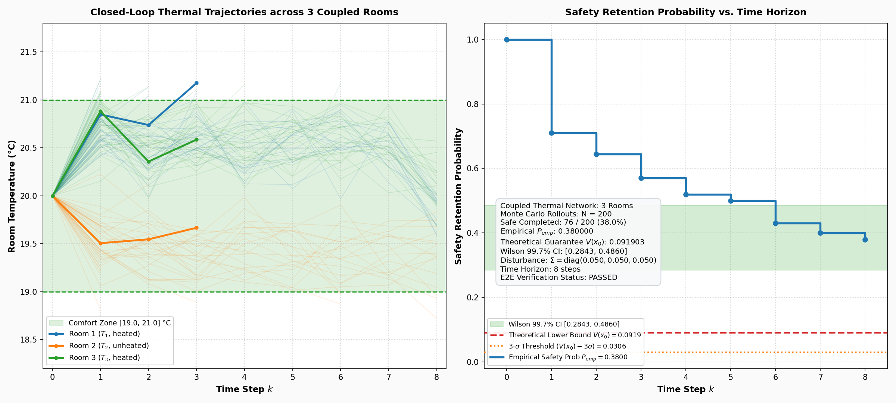

# **AMYTISS**: Parallel Automated Controller Synthesis for Large-scale Stochastic Systems  

[](https://github.com/mkhaled87/pFaces-AMYTISS/actions/workflows/ci.yml)
[](https://github.com/parallall/pFaces)
[](LICENSE)

> **Note:** This tool works on top of the demo version of pFaces. If you face any LICENSE issues (e.g., expired license), install the latest version of pFaces or use the latest license file from the latest demo version of pFaces. Latest demo version of pFaces can always be found [here](https://github.com/parallall/pFaces/releases).

Stochastic control systems are recently used to model and analyze various safety-critical systems such as traffic networks and self-driving cars.
**AMYTISS** is introduced as a software tool, implemented as a kernel on top of the acceleration ecosystem [pFaces](https://github.com/parallall/pFaces), for designing correct-by-construction controllers of stochastic discrete-time systems.

Check the presentation video of AMYTISS for a quick introduction and a demo:

<p align="center"> 
    <a href="https://www.youtube.com/watch?v=tEcv0mdA6Yc">
        
    </a>
</p>

AMYTISS is used to:

- build finite Markov decision processes (MDPs) as finite abstractions of given original stochastic discrete-time systems; and  

- synthesize controllers for the constructed finite MDPs satisfying bounded-time safety specifications and reach-avoid specifications.

In AMYTISS, scalable parallel algorithms are designed to construct finite MDPs and to synthesize their controllers. They are implemented on top of pFaces as a kernel that supports parallel execution within CPUs, GPUs and hardware accelerators (HWAs). 

## **Installation using Docker**
Here, we assume you will be using Linux or MacOS machine. Commands will be slightly different on Windows if you use Windows PowerShell.

First, make sure to configure Docker to use all of the resources available (e.g., all CPU cores). Otherwise, AMYTISS will run slower than expected. Also, in case you are using a GPU, make sure to pass-through the GPU in Docker. See this [guide](https://docs.docker.com/config/containers/resource_constraints/).

Download the Dockerfile:
``` bash
$ mkdir amytiss
$ cd amytiss
$ wget https://raw.githubusercontent.com/mkhaled87/pFaces-AMYTISS/master/Dockerfile
```    

Build the Docker image:
``` bash
$ docker build -t amytiss/latest .
```    

Run/enter the image's interactive shell
``` bash
$ docker run -it amytiss/latest
```    

Now you can use AMYTISS. It is located in the director **pFaces-AMYTISS** and you can navigate to it as follows:
``` bash
$ cd pFaces-AMYTISS
```

In the Docker image, we installed Oclgrind to simulate an OpenCL platform/device that utilizes all the CPU cores usign threads. Unless you will be passing-through your device (e.g., a GPU), you MUST preced any pFaces command with oclgrind. For example, to check available devices in the prespective of Oclgrind, run:
``` bash
$ oclgrind pfaces -CG -l
```

## **Installation using Source Code**

### **Prerequisites**

#### pFaces

You first need to have have [pFaces](https://github.com/parallall/pFaces) installed and working. Test the installation of pFaces and make sure it recognizes the parallel hardware in your machine by running the following command:

``` bash
$ pfaces -CG -l
```

where **pfaces** calls pFaces launcher as installed in your machine. This should list all available HW configurations attached to your machine and means you are ready to work with AMYTISS.

#### Build tools

AMYTISS is given as source code that need to be built before running it. This requires a modern C/C++ compiler such as:

- For windows: Microsoft Visual C++ (AMYTISS is tested with Visual Studio 2019 community edition);
- For Linux/MacOS: GCC/G++.

### **Building AMYTISS**

AMYTISS uses CMake for cross-platform building.
We support Windows, Linux and MacOS.
AMYTISS was tested on Windows 10x64, Linux Ubuntu 18.04 and MacOS 10.
In Windows, you must use the developer command prompt of Visual Studio so that CMake is integrated.
Start by cloning this repo to some place in your machine (commands prompt is a little different in Windows):

``` bash
$ git clone --depth=1 https://github.com/mkhaled87/pFaces-AMYTISS
```

Now, run the build script that automates the CMake-based build.
For MacOS/Linux:

``` bash
$ cd pFaces-AMYTISS
$ ./build.sh
```

For MacOS/Linux:

``` bash
> cd pFaces-AMYTISS
> .\build.bat
```

A successful build will generate the kernel driver `amytiss.driver` in the `kernel-pack` folder.

## **Getting Started**

Now, you have AMYTISS installed and ready to be used. You might now run a given example or build your own.

### **File structure of AMYTISS**

- [examples](/examples): the folder contains pre-designed examples.
- [interface](/interface): the folder contains the Matlab interface to access the files generated by AMYTISS.
- [kernel](/kernel): the folder contains C++ source codes of AMYTISS pFaces driver.
- [kernel-pack](/kernel-pack): the folder contains the OpenCL codes of the AMYTISS and will finally hold the binaries of the loadable kernel of AMYTISS.

### **Running an example**

Navigate to any of the examples in the directory [/examples](/examples). Within each example, one or more .cfg files are provided. Config files tells AMYTISS about the system under consideration and the requirements it should consider when designing a controller for the system.

Say you navigated to the example in [/examples/ex_toy_safety](/examples/ex_toy_safety) and you want to launch AMYTISS with the config file [toy2d.cfg](/examples/ex_toy_safety/toy2d.cfg), then run the following command from any terminal located in the example folder:

``` bash
$ pfaces -CG -d 1 -k amytiss@../../kernel-pack -cfg toy2d.cfg -p
```

where **pfaces** calls pFaces launcher, "-CG -d 1" asks pFaces to run AMYTISS in the first device of all available devices, "-k amytiss@../../kernel-pack" tells pFaces about AMYTISS and where it is located, "-cfg toy2d.cfg" asks pFaces to hand the configuration file to AMYTISS, and "-p" asks pFaces to collect profiling information. Make sure to replace each / with \ in case you are using Windows command line.

## **Verified Stochastic Controller Synthesis Benchmarks**

AMYTISS includes an end-to-end (E2E) automated verification suite that validates synthesized controllers against their theoretical dynamic-programming satisfaction guarantees $V(x_0)$ via closed-loop Monte Carlo rollouts under additive Gaussian disturbance.

The entire benchmark suite can be executed with a single command:
```bash
./test.sh
```

---

### **1. 2D Stochastic Reachability (`ex_toy_reach`)**

Validates finite-horizon stochastic reachability for a 2D non-linear system under additive Gaussian noise.

* **Dynamics:**
  $$\begin{cases} x_0(k+1) = x_0(k) + 2 u_0(k) \cos(u_1(k)) + w_0(k) \\ x_1(k+1) = x_1(k) + 2 u_0(k) \sin(u_1(k)) + w_1(k) \end{cases}$$
  where state $x \in [-10.0, 10.0]^2$ ($\eta_x = [0.5, 0.5]$), input $u \in [-1.0, 1.0]^2$ ($\eta_u = [0.1, 0.1]$), and disturbance $w \sim \mathcal{N}(0, \Sigma)$ with $\Sigma = \operatorname{diag}(0.75, 0.75)$.
* **Specification:** Steer the system from $x_0 = [-1.5, -1.5]$ into Target Set $T = [5.0, 8.0] \times [5.0, 8.0]$ within $T = 16$ time steps.
* **Theoretical Guarantee:** $V(x_0) = 0.999236$ (99.92%).
* **Verification Result:** $1000 / 1000$ rollouts reached the target ($P_{\text{emp}} = 100.0\%$, Wilson 99.7% CI: $[0.9911, 1.0000]$), reaching target in $5.83 \pm 1.18$ steps on average.

**Commands to run synthesis and verification:**
```bash
cd examples/ex_toy_reach
pfaces -CG -k amytiss.cpu@../../kernel-pack -cfg ./toy2d.cfg -d 1 -p
python3 ./verify_closedloop.py
```



---

### **2. 2D Stochastic Safety Invariance (`ex_toy_safety`)**

Validates stochastic safety invariance for a high-gain non-linear control system.

* **Dynamics:**
  $$\begin{cases} x_0(k+1) = x_0(k) + 10 u_0(k) \cos(u_1(k)) + w_0(k) \\ x_1(k+1) = x_1(k) + 10 u_0(k) \sin(u_1(k)) + w_1(k) \end{cases}$$
  where state $x \in [-10.0, 10.0]^2$ ($\eta_x = [0.5, 0.5]$), input $u \in [-1.0, 1.0]^2$ ($\eta_u = [0.2, 0.2]$), and disturbance $w \sim \mathcal{N}(0, \Sigma)$ with $\Sigma = \operatorname{diag}(0.75, 0.75)$.
* **Specification:** Maintain the state strictly within Safe Set $S = [-10.0, 10.0] \times [-10.0, 10.0]$ from $x_0 = [0.0, 0.0]$ across all $T = 8$ time steps.
* **Theoretical Guarantee:** $V(x_0) = 0.997943$ (99.79%).
* **Verification Result:** $200 / 200$ rollouts remained safely inside bounds ($P_{\text{emp}} = 100.0\%$, Wilson 99.7% CI: $[0.9569, 1.0000]$).

**Commands to run synthesis and verification:**
```bash
cd examples/ex_toy_safety
pfaces -CG -k amytiss.cpu@../../kernel-pack -cfg ./toy2d.cfg -d 1 -p
python3 ./verify_safety.py
```



---

### **3. 2D Obstacle Circumnavigation Reach-Avoid (`ex_toy_reachavoid`)**

Validates stochastic reach-avoid synthesis where an unsafe obstacle set separates the initial state envelope from the target set.

* **Dynamics:**
  $$\begin{cases} x_0(k+1) = x_0(k) + 2 u_0(k) \cos(u_1(k)) + w_0(k) \\ x_1(k+1) = x_1(k) + 2 u_0(k) \sin(u_1(k)) + w_1(k) \end{cases}$$
  where state $x \in [-10.0, 10.0]^2$ ($\eta_x = [0.5, 0.5]$), input $u \in [-1.0, 1.0]^2$ ($\eta_u = [0.1, 0.1]$), and disturbance $w \sim \mathcal{N}(0, \Sigma)$ with $\Sigma = \operatorname{diag}(0.75, 0.75)$.
* **Specification:** Reach Target Set $T = [5.0, 8.0] \times [5.0, 8.0]$ from $x_0 = [-2.5, 3.5]$ within $T = 16$ time steps while strictly avoiding Obstacle $A = [-1.5, 1.5] \times [-1.5, 1.5]$.
* **Theoretical Guarantee:** $V(x_0) = 0.999380$ (99.94%).
* **Verification Result:** $199 / 200$ rollouts reached the target without obstacle collision ($P_{\text{emp}} = 99.50\%$, 1 avoid hit, Wilson 99.7% CI: $[0.9478, 0.9995]$), circumnavigating the obstacle north and reaching target in $4.74 \pm 1.00$ steps on average.

**Commands to run synthesis and verification:**
```bash
cd examples/ex_toy_reachavoid
pfaces -CG -k amytiss.cpu@../../kernel-pack -cfg ./toy2d.cfg -d 1 -p
python3 ./verify_reachavoid.py
```



---

### **4. 3-Room Coupled Continuous Thermal Comfort Control (`ex_roomtemp3`)**

Validates multi-room thermal network safety where heat transfers between coupled rooms and dissipation occurs to a cold outdoor environment ($T_e = -1.0^\circ\text{C}$).

* **Dynamics:**
  $$\begin{cases} x_0(k+1) = (a - \gamma u_0) x_0 + \eta_c (x_1 + x_2) + \gamma T_h u_0 + \beta T_e + w_0 \\ x_1(k+1) = a x_1 + \eta_c (x_0 + x_2) + \beta T_e + w_1 \\ x_2(k+1) = (a - \gamma u_1) x_2 + \eta_c (x_0 + x_1) + \gamma T_h u_1 + \beta T_e + w_2 \end{cases}$$
  where $a = 1 - 2\eta_c - \beta = 0.578$, $\eta_c = 0.20$, $\beta = 0.022$, $\gamma = 0.05$, $T_h = 50.0^\circ\text{C}$, $T_e = -1.0^\circ\text{C}$. Heaters in Rooms 1 and 3 are actuated ($u \in [0.0, 1.0]^2$), while Room 2 is unheated. Additive noise $w \sim \mathcal{N}(0, \Sigma)$ with $\Sigma = \operatorname{diag}(0.05, 0.05, 0.05)$ ($\sigma = 0.2236^\circ\text{C}$).
* **Specification:** Maintain all three room temperatures inside Comfort Zone $S = [19.0, 21.0]^\circ\text{C}^3$ from $x_0 = [20.0, 20.0, 20.0]^\circ\text{C}$ for all $T = 8$ time steps.
* **Theoretical Guarantee:** $V(x_0) = 0.091903$ (9.19%).
* **Verification Result:** $76 / 200$ rollouts remained completely inside comfort bounds ($P_{\text{emp}} = 38.00\% \ge 9.19\%$, Wilson 99.7% CI: $[0.2843, 0.4860]$), meeting and exceeding the theoretical lower bound.

**Commands to run synthesis and verification:**
```bash
cd examples/ex_roomtemp3
pfaces -CG -k amytiss.cpu@../../kernel-pack -cfg ./roomtemp3.cfg -d 1 -p
python3 ./verify_safety.py
```



---

## **Designing your own example**

We recommend copying and modifying one of the provided examples to avoid syntactical mistakes. Examples are simply configuration files that asks AMYTISS to achieve specific tasks. The next subsection will guide you understand the fields in AMYTISS config files.

### **The configuration files**

Each configuration file corresponds to a case describing a stochastic system and the requirements to be used to synthesize a controller for it. Config files are plain-text files with scopes and contents (e.g., "scope_name { contents }"), where the contents is a list of ;-separated key="value" pairs. Note that values need to be enclosed with double quotes. For a better understanding of such syntax, take a quick look to this [example config file](/examples/ex_toy_safety/toy2d.cfg). 

The following are all the keys that can be used in AMYTISS config files:


- **project_name**: a to describe the name of the project (the case) and will be used as name for output files. If not provided, this key will be set to *"empty_project"*.

- **data**: describes the used data model and should be currently set to "raw". If not provided, this key will be set to *"empty_project"*.

- **include_files**: This field is optional. It describes the a list of any additional OpenCL code files the users wish to include into the computation process. This allows users to, for example, include custom PDF functions or custom dynamics of the systems. This is what makes AMYTISS extensible to the finest grain level.

- **save_transitions**: a "true" or "false" value that instructs AMYTISS to construct and save the MDP (a.k.a., the Probabilities matrix) or ignore it and do the computation on the fly (OTF). When not provided, the default value is *"false"*.

- **save_controller**: a "true" or "false" value that instructs AMYTISS to save the controller or not. When not provided, the default value is *"true"*.

- For the scopes **states** (required), **inputs** (required), or **disturbances** (optional), the following keys must be provided:
    - **dim**: an integer declaring the dimension.
    - **lb**: a comma-separated list giving the top-right corner vector.
    - **ub**: a comma-separated list giving the bottom-left corner vector.

- The scope **post_dynamics** is required and it describes the system. The following keys are used inside this scope:
    - **xx0** to **xx21** (required): the left-hand-side of each component of the difference equation of the system.
    - **constant_values** (optional): a single line OpenCL codes declaring constant values. The code line, or any internal lines, should end with ;.
    - **code_before** (optional) and **code_after** (optional): two lines of OpenCL codes that will preceed or succeed the dynamics **xx0** to **xx21**.

- The scope **noise** is required and it describes the noise. The following keys are used inside this scope:
    - **type**: this describes whether the noise is *"additive"* or *"multiplicative"*. When not specified, the default value is *"additive"*.
    - **pdf_truncation**: this describes how AMYTISS can truncate the probability density function (PDF) in order to save the memory. This can be one of the following: *"no_truncation"* (the probabilities will be recorded for all state variables below the PDF surface), *"fixed_truncation"* (the probabilities will be recorded for a fixed region of the state space around the origin and will be shifted as the PDF is shifted), or *"cutting_probability"* (the probabilities will be recorded only when they are above this value). When not specified or when the **type** is set to *"multiplicative"*, this key will be set to *"no_truncation"*.
    - **cutting_probability**: this must be provided when **pdf_truncation** is set to *"cutting_probability"*. It is a value for the truncation of the PDF at specific probability level. Setting it to "0" is equivalent to setting **pdf_truncation** to *"no_truncation"*.
    - **cutting_region**: this must be provided when **pdf_truncation** is set to *"fixed_truncation"*. It is a comma-separated list of lower/upper values for each component of the states.dim components. This sets explicitly the origin-centered truncation region of the PDF. 

    - **pdf_class**: this describes the class of the PDF. This can be any of the following values: *"normal_distribution"*, *"uniform_distribution"*, *"exponential_distribution"*, or *"custom"*. Each of the previous values may require additional configurations that we describe separately:
    - For **pdf_class**=*"normal_distribution"*, the following keys are required:
        - **inv_covariance_matrix**: the inverse of the covariance matrix $\Sigma$ as list of values. You can provide states.dim^2 values which refers to the complete matrix or provide states.dim values which refers to the diagonal of a diagonal covariance matrix.
        - **det_covariance_matrix**: the determinant of the covariance matrix. This must be consistent with the covariance matrix and follows (det_covariance_matrix = det(inv(inv_covariance_matrix))). We were lazy to compute this and we ask the users to provide. Sorry !
    - For **pdf_class**=*"uniform_distribution"*, the following keys are required:
        - **active_region**: this is the non-zero region under the surface of the uniformly distributed PDF. It is a comma-separated list of lower/upper values for each component of the states.dim components. The amplitude of the PDF is computed automatically to be 1/volume(active_region).
    - For **pdf_class**=*"exponential_distribution"*, the following keys are required:
        - **decay_rate**: this is a scalar value representing the decay rate of the exponential distribution.
    - For **pdf_class**=*"beta_distribution"*, the following keys are required:
        - **alpha**: a scalar value for parameter alpha.
        - **beta**: a scalar value for parameter beta.

- The scope **specs** is required and it describes the specifications to be applied to the system when synthesizing the controller. The following keys are used inside this scope:
    - **type** (required): the targeted specifications and can have one of the following values:
        - "safe" for safety specifications, that is finding a controller to keep the system in its state space.
        - "reach" for reachability (or reach-avoid) specifications, that is finding a controller to reach some target set of states. There is a also a possibility of providing some set of avoid states.
    - **hyperrect** (required): a comma-separated list of lower/upper values for each component of the states.dim components describing the safe region or the target region, for safety or reachability specifications, respectively.
    - **avoid_hyperrect**: in case type="reach", this comma-separated list of lower/upper values for each component of the states.dim components describes an avoid set.
    - **time_steps**: (required): the time bound $T_d$ to satisfy the specifications.

### **Adding a custom PDF**
To add a custom PDF to AMYTISS, you need to first set the **pdf_class** to *"custom"*. AMYTISS will then expect a file *custom_pdf.cl* next to the configuration file. The file should contain the code:

``` c
#define CUTTING_REGION_LB {...}         // lower-left corner of the truncation region.
#define CUTTING_REGION_UB {...}         // upper-right corner of the truncation region.
#define CUTTING_REGION_WIDTHS {...}     // widths (number of quantization steps) in each
                                        // dimension inside the truncation region.
#define NUM_REACH_STATES ...            // total number of quantized states in the truncation region.

// The custom PDF
custom_pdf(const concrete_t* x, const concrete_t* Mu){
    return ... ;                        // should compute and return the PDF(x) value 
                                        // when the PDF is shifted to Mu.
}
```

## **Authors**

- [**Mahmoud Khaled**](http://www.mahmoud-khaled.com)*.
- [**Abolfazl Lavaei**](http://www.hyconsys.com/members/lavaei)*.
- [**Sadegh Soudjani**](http://homepages.cs.ncl.ac.uk/sadegh.soudjani/).
- [**Majid Zamani**](http://www.hyconsys.com/members/mzamani).

*: Both authors have the same contribution.

## **Publications**

- A. Lavei, M. Khaled, S. Soudjani, M. Zamani. AMYTISS: Parallelized Automated Controller Synthesis for Large-Scale Stochastic Systems. 32nd Conference on Computer Aided Verification (CAV), to appear, July 2020.
- A. Lavei, M. Khaled, S. Soudjani, M. Zamani. Poster: AMYTISS: A Parallelized Tool on Automated Controller Synthesis for Large-Scale Stochastic Systems. 23rd ACM International Conference on Hybrid Systems: Computation and Control (HSCC 2020), Sydney, Australia April 2020

Please cite the tool paper as follows:

    @inproceedings{AMYTISS,
        title = {AMYTISS: Parallelized Automated Controller Synthesis for Large-Scale Stochastic Systems},
        author = {Lavaei, Abolfazl and Khaled, Mahmoud and Soudjani, Sadegh and Zamani, Majid},
        booktitle = {Proc. 32nd International Conference on Computer Aided Verification (CAV)},
        publisher = {Springer},
        series = {LNCS},
        year = {2020}
    }


## **License**

See the [LICENSE](LICENSE) file for details
